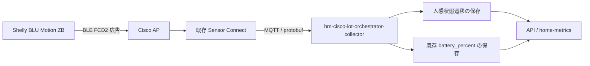

# Shelly BLU Motion ZB を Cisco AP で収集する計画

作成日: 2026-11-14。状態: 開発実装・Cisco 実機検証を実施。以下は当初計画であり、実装・配備・制限の正本は [対応文書](shelly-blu-motion-zb.md) を参照。本格的な CI/CD 反映はユーザーの了承待ち。

## 目的と対応範囲

`FC:4D:6A:26:53:E3`（`SBMO-103Z`）の人感イベントと電池残量を Cisco AP 経由で home-metrics に保存する。

| 対象 | 取得・保存方針 |
| --- | --- |
| 人感 | BTHome `0x21`。検出・解除の状態遷移を受信時刻付きで保存 |
| 電池 | BTHome `0x01`。既存の `battery_percent` を使い、値と観測時刻を保存 |
| 明るさ・ボタン | パケットを安全に解析するために長さは扱うが、値を永続化・表示しない |
| FW・設定 | 初期調査情報として既存の調査記録に残す。常時 GATT 収集は追加しない |

センサーの Beacon mode は現在の無効を維持する。まず人感のイベント広告と通常周期広告を使って検証する。30秒周期への変更は本計画の実行条件にしない。

## 実機で確認できた根拠

pve2 で2026-11-14 15:50:13〜16:07:29 JST、約17分16秒観測した。ユーザーの「この時点でデータはそろった」という指示に合わせ、予定していた30分を待たず終了した。

| 時刻（JST） | 人感状態 | packet ID | ServiceData |
| --- | --- | --- | --- |
| 15:50:17 | 未検出 | `0x10` | `440010016421006400` |
| 15:50:42 | 検出 | `0x11` | `440011016421016400` |
| 15:53:34 | 解除 | `0x12` | `440012016421006400` |
| 15:53:54 | 検出 | `0x13` | `440013016421016400` |
| 15:58:20 | 解除 | `0x16` | `440016016421006400` |

すべて電池 `01 64` = 100% を含む。広告は暗号化なしの BTHome v2。人感・電池の取得に GATT 接続は不要。

256件の BlueZ 広告更新を記録したが、同一広告の繰り返しを含み、異なる payload は7種類だった。そのうち5種類が上表の人感状態、2種類はボタン広告。RSSI は -74〜-45 dBm。256回の人感イベントを検出したという意味ではない。

観測中には SSH 出力の Broken pipe と、探索セッション引き継ぎに伴う BlueZ の `Discovering=false` / `InProgress` が発生した。15:58:47〜16:02:43付近は連続受信の根拠に使用しない。16:02:43以降は探索状態を復旧・確認した。したがって、このログからセンサーの通常送信周期や取りこぼし率は確定しない。終了時は診断プロセス停止と `Discovering=false` を確認した。

生ログは pve2 の `/tmp/shelly-motion-30m-og18x52w/events.jsonl`、回収コピーはローカル `/private/tmp/shelly-motion-investigation/events.jsonl`。どちらも一時保存である。

## 採用する経路



既存 Flower Care と同じ Sensor Connect 経路を拡張する。Firehose collector は使用しない。AP に Shelly 固有のデコーダーを実装する必要はなく、広告の生バイトを collector で BTHome として解析する。

既存運用手順上の接続先は REST `https://192.168.67.6:8081`、MQTT `192.168.67.6:41883`。実行時は nms4 の稼働設定と照合する。AP は既存の BLE Scan 対応 AP のうち設置場所に近い1台から始める。既存資料に `TYO7AP1` / `TYO7AP3` があるが、今回どちらが受信に適するか、現在 Sensor Connect に接続しているかは未確認。

## フェーズ1: Cisco AP から広告が届くことを確認

### 1. 現行設定の読み取りと保全

実行場所は nms4 と Sensor Connect Web UI。

1. 稼働中の MQTT collector、API/MQTT 接続先、topic、onboarding/control/data アプリ ID を確認する。API key はホスト内の環境・非公開ファイルから読み、ログや文書へ出さない。
2. 現行 AP scan/filter profile、対象 AP、SCIM 登録、topic subscription を保全する。
3. Inventory → Access Point で AP の機種、接続状態、BLE radio、現在の profile を確認し、最初の受信 AP を選ぶ。
4. センサーの実際の BLE address type を BlueZ の `AddressType` または AP の受信情報で確認する。MAC が安定していることだけで `isRandom=false` と判断しない。random static の場合は、private address の drop 設定との相性も確認する。

### 2. AP のスキャン許可リスト

Sensor Connect UI で以下を行う。

1. Configuration → Filter Configuration で、選んだ AP の既存 allow-list に **完全な MAC `FC:4D:6A:26:53:E3` だけを追加**する。既存エントリーは保持する。
2. Configuration → Scan Configuration で対象 profile の BLE scan を有効にする。既存 scan interval/window を記録し、まずその値を使う。復旧手順には両方 `100` の実績があるが、単位や機種差を確認せず転記しない。
3. AP が **Connected / Radio Up / Scan / In Sync** になることを確認する。
4. BLE Inventory で対象 MAC の Last Heard が更新されることを確認する。最初はボタン短押しで識別し、その後は人感イベントで検証する。

人感イベントの広告時間は仕様上約1秒なので、受信漏れがあれば scan duty cycle と AP の重複排除・上流転送間隔を調べる。広告の検出と MQTT への転送を別々に確認する。Wi-Fi / AP / WLC 全体の再起動はこの追加作業に含めない。

### 3. 対象デバイスの SCIM 登録

1. `GET /scim/v2/Devices?onboardApp=<既存onboarding app>` で MAC を照合する。
2. 未登録の場合だけ `POST /scim/v2/Devices` で登録する。onboarding app の API key を使い、既存の control/data app に関連付ける。
3. `isRandom` は手順1で確認した値を指定する。pairing は広告収集用の null とし、センサーとのボンディングは要求しない。
4. 返された device UUID を記録する。DB の機器キーである MAC と混同しない。

ボディは既存の Sensor Connect 1.2.2 復旧手順の受理済み形式を使う。`versionSupport` は本機の Bluetooth 5 LE と実際の API の許容値を照合する。Flower Care 登録例にある `5.3` を本機の仕様として転記しない。

### 4. FCD2 広告の topic 登録

既存の data app と MQTT topic を再利用し、**この1台の広告購読だけを追加**する。data app が登録済みなら再登録・topic 変更を行わない。

control app の API key で `POST /control/registration/registerTopic` を実行する。既存 FE95 登録方式を踏襲したリクエスト候補は次のとおり。

```json
{
  "technology": "ble",
  "id": "<ShellyのSCIM device UUID>",
  "ids": ["<ShellyのSCIM device UUID>"],
  "controlApp": "<既存control app ID>",
  "topic": "<既存CISCO_IOT_ORCH_TOPIC>",
  "dataFormat": "default",
  "ble": {
    "type": "advertisements",
    "serviceID": "fcd2",
    "characteristicID": "fcd2"
  }
}
```

`fcd2/fcd2` は既存の `fe95/fe95` 登録実績に基づく候補で、Shelly での受理・配信は未検証。広告に実在する GATT characteristic を意味しない。API の必須項目として指定し、使用中バージョンでの形式を確認する。HTTP 成功だけでなく `status=SUCCESS` と Device Topics の当該 UUID の ADVERTISEMENT 登録、実データ到着を確認する。既存登録を書き換える動作だった場合は中断して対象を分離する。広告用に GATT の `/control/data/subscribe` は追加しない。

### 5. DB に書かない MQTT 診断

既存 collector はまだ FCD2 を解析できない。`CISCO_IOT_ORCH_DEBUG=true` は topic とバイト数しか出さないので、それだけを受信成功の証拠にしない。

実装する最初の成果物は `tools/shelly_sensor_connect_probe.go`。既存 MQTT/protobuf 処理を利用し、次の性質にする。

- nms4 から既存 MQTT topic を購読する。診断用の固有 client ID を使用する。
- 対象 MAC のみを出力し、`device_id`、`ap_mac`、元の時刻、受信時刻、RSSI、広告 hex と人感・電池の解析結果を記録する。
- DB 接続、デバイス自動登録、data app 再登録、GATT 接続は行わない。
- 他のセンサーのペイロードや認証情報は出力しない。対象の生広告は短期の診断ログとして扱う。

既存 topic 上の独立した MQTT subscriber として併走し、既存 collector の client ID を流用しない。併走購読が既存配信に影響しないことも実機で確認する。本番 sensors.json への追加はフェーズ2まで待つ。

フェーズ1の合格条件: AP の Last Heard 更新に加え、MQTT 内の対象 MAC の広告から `motion=1` / `motion=0` と `battery=100` を解析できること。protobuf の `data` が完全な AD structures か service data のみかを実パケットで確定する。

## フェーズ2: home-metrics に人感・電池を保存

### デコーダー

`cmd/hm-cisco-iot-orchestrator-collector/decoder.go` の AD 解析を UUID 付きで扱うようにし、`0xFCD2` を明示的に BTHome デコーダーへ振り分ける。既存 FE6A / FE95 の処理は保持する。

- `0x00` packet ID、`0x01` battery、`0x21` motion を取得する。
- `0x3A` button と `0x64` light level は値を保存せず、正しいバイト数だけ読み進める。
- FW/機種パケットや未知 object が来ても、人感を勝手に false にしない。未知 object は長さ不明ならそこで解析を停止する。
- 暗号化フラグ付き、切れた広告、未対応バージョンを正常値として扱わない。
- pve2 の取得データを fixture にし、少なくとも検出・解除・電池・ボタンのみ・重複・破損のケースをテストする。

### 人感は状態遷移として保存

既存の1分 median aggregation には通さず、型付きの人感状態保存を追加する。

- 新規の `sensor_motion_events` に、機器 MAC、観測時刻、collector受信時刻、`motion boolean`、packet ID、受信 AP を保存する。初回の観測は初期状態として区別する。
- 直前と同じ人感状態の広告は新しい検出・解除イベントにしない。ただし最終受信時刻と電池の処理は進める。周期広告とイベント広告を、生データだけから断定して分類しない。
- 複数 AP と繰り返し広告の重複は `(MAC, packet ID, payload)` と短い受信時間窓で排除する。窓の初期候補は5秒とし、AP→MQTT 遅延の実測で調整する。packet ID 単独は循環・再起動があるため永続的な一意キーにしない。
- 元の観測時刻より古い遅延データで最新状態を巻き戻さない。時刻がない場合は受信時刻を使用したことを識別できるようにする。
- 最後の動きから60秒を過ぎても、collector が解除イベントを捏造しない。解除は受信した `motion=0` に基づく。古い状態は鮮度とともに示す。
- 機器の last-seen と現在状態を少量の最新状態テーブルで保持し、再起動後の重複と鮮度判断にも使う。

### 電池は既存項目を使う

`0x01` がある広告から `battery_percent` を取り込み、既存の分単位保存と latest API の値別タイムスタンプを使用する。人感が変化しない周期広告やボタン広告でも、電池値があれば更新できる。

同一広告の繰り返しは分内でまとめる。前回の電池値を新しい時刻で補間・再保存しない。API には100%という値と実観測時刻を返す。15分周期のセンサーに既定の5分鮮度判定をそのまま適用せず、まず実配信周期を確認し、本機の last-seen 判定は45分を初期候補とする。

### 型登録・API・保存先

新しい migration と fresh-install schema に `shelly_blu_motion_zb` のセンサー種別、人感用テーブルを追加する。既存 migration は編集しない。

本番の sensor 定義の追加案:

```json
{
  "mac": "FC:4D:6A:26:53:E3",
  "label": "Shelly Motion",
  "location": "<設置場所>",
  "ingest_source": "cisco_sensor_connect",
  "sensor_type_code": "shelly_blu_motion_zb",
  "sensor_category": "motion",
  "enabled": true
}
```

`motion` category は追加する設計値で、現時点で実装済みという意味ではない。GATT battery 設定は不要。pve2 collector との二重 ingest は行わない。

既存 latest API に人感状態とその観測時刻を追加し、イベント履歴取得 API を追加する。電池は既存 `battery_percent` / `value_timestamps.battery_percent` を維持する。時系列グラフで人感を連続量として平均・補間しない。OpenAPI と UI、センサー鮮度チェックもイベント型に対応させる。電池や RSSI の処理を人感イベント数に数えない。

## 検証と反映順序

1. **Cisco 配信だけを確認**: AP 1台・対象 MAC 1台から開始し、診断ログで広告を確認する。
2. **回帰確認**: 既存の FE6A / Flower Care が同じ topic で継続受信できることを確認する。
3. **実装検証**: pve2 fixture と Cisco 実パケットでデコーダー、状態遷移、電池保存、重複、順不同、再起動をテストする。`make test` / `make build` と OpenAPI の検証を実施する。
4. **実機の繰り返し確認**: 当初は5サイクルを目安としたが、2026-11-14のユーザー指示により Cisco 経由4組で終了した。人感・電池の経路を DB/API まで確認した。pve2 との同時対照試験は未完了であり、pve2 の事前取得データをデコーダー fixture に使った。
5. **通常周期確認**: 無動作で30分以上置き、Beacon mode 無効の通常広告が AP/MQTT まで届くか、同じ値でも最終受信時刻が更新できるか確認する。届かなければ AP/上流の抑制設定を先に調査する。
6. **反映**: home-metrics の CI・image publish、servicecore の digest 更新、DB migration、対象 collector の反映の順で実施する。実行段階で現在の配備手順を確認する。
7. **反映後**: 人感履歴と電池値・観測時刻、既存センサーの継続、collector の鮮度を確認する。

即時イベントの到達性は保証としない。現 MQTT 実装は QoS 0 で購読しており、AP の広告取りこぼし・上流抑制・通信断は発生し得る。通常周期広告は最新状態の補正に使えるが、失われた過去の検出・解除履歴は復元できない。合格条件は管理したテストでの受信一致とし、24時間以上の運用観測で実際の到達性を評価する。

## ロールバック

- 診断フェーズでは Shelly 1台の subscription と追加した MAC エントリーだけを戻す。共有 data app/topic や既存の FE6A/FE95 登録を一括解除しない。
- 配備後は対象機器の収集を無効化して collector の変更を戻せるようにする。人感・電池の既存記録は保持する。
- DB は加算的な migration とし、ロールバック時も既存テーブルや履歴を削除しない。

## 実行前に確定する項目

- 実際に使う AP とその BLE Scan 状態、profile、既存の重複排除・転送設定。
- 本機の BLE address type と SCIM `isRandom`。
- `fcd2/fcd2` の登録形式と MQTT 上の実ペイロード構造。
- 設置場所・表示名。

これらは既存環境の読み取りとフェーズ1で確定する。センサーの Beacon mode・感度・FW を先に変更する必要はない。

## 参照

- [本機の実機調査](shelly-blu-motion-zb-investigation.md)
- [既存 Flower Care の Cisco 経路](xiaomi-flower-care-cisco-sensor-connect.md)
- ローカル運用正本: `/Users/hshimomu/Documents/ioslab-docs/servicecore/hosts/nms4/docker/home-metrics/SENSOR_CONNECT_RECOVERY.md`
- [Cisco: Topic 登録 API](https://developer.cisco.com/docs/spaces-connect-for-iot-services/register-a-topic/)
- [Cisco: BLE telemetry](https://developer.cisco.com/docs/spaces-connect-for-iot-services/data-telemetry-from-ble-devices/)
- [Shelly: BLU Motion ZB 技術仕様](https://shelly-api-docs.shelly.cloud/docs-ble/Devices/BLU_ZB/BluMotionZB/)
